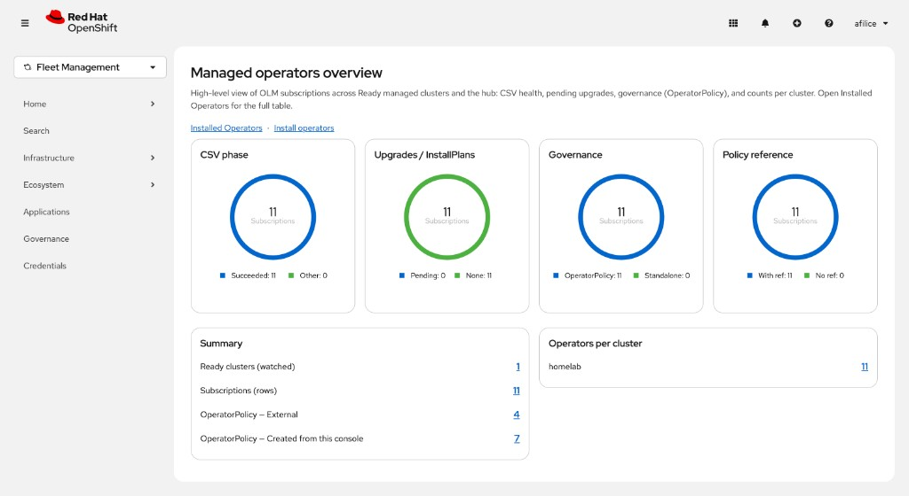
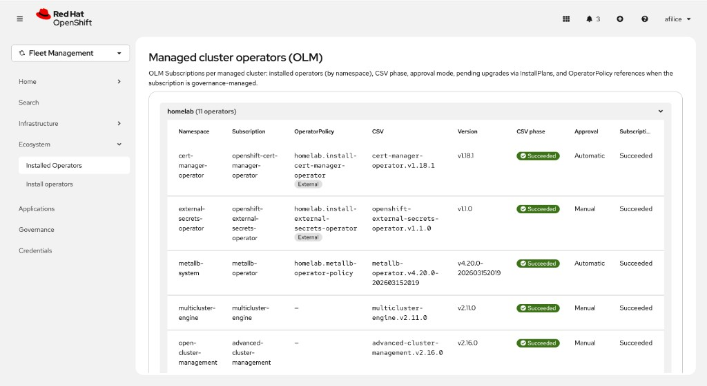
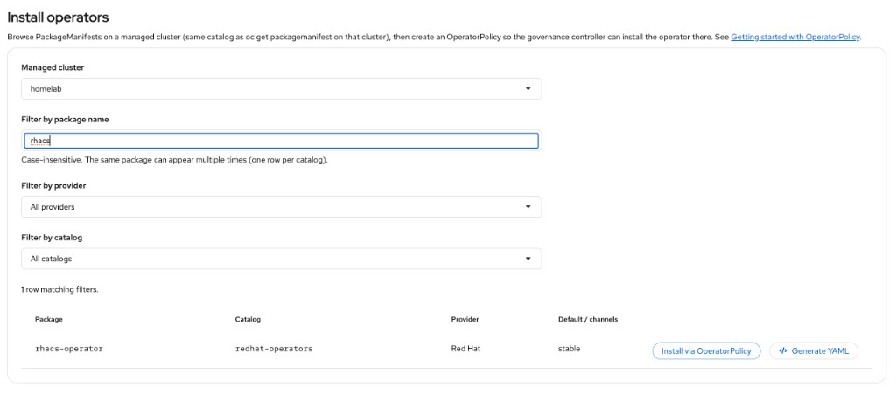
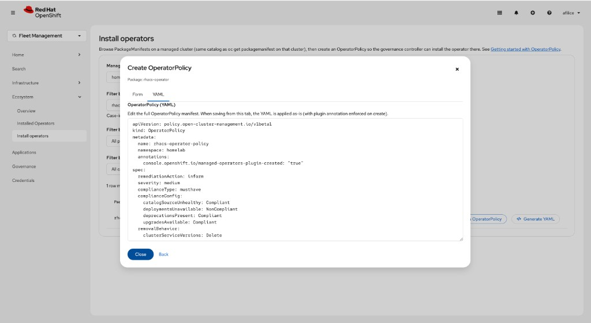
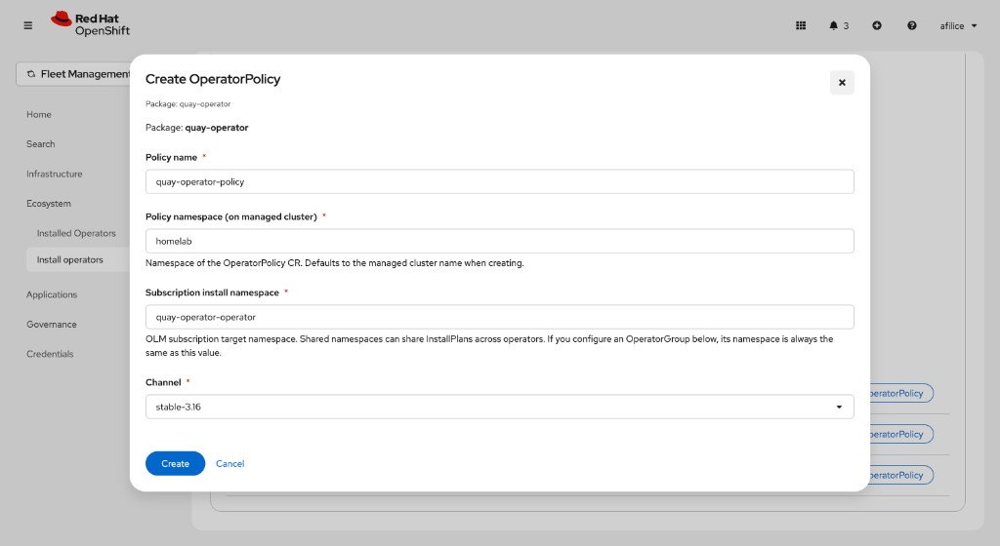

# managed-operators-plugin

Dynamic console plugin for **Red Hat Advanced Cluster Management (RHACM)** / **multicluster engine (MCE)**. It extends the OpenShift console in the **All clusters (ACM)** perspective with views for OLM operators on managed clusters.

## Features

- **Overview** (`/multicloud/ecosystem/managed-operators-overview`): dashboard-style summary with **ChartDonut** cards (CSV health, pending upgrades, governance vs standalone OLM, policy reference) plus per-cluster counts and links to the other plugin pages. Each segment count and summary line is a **drill-down** link to **Installed Operators** pre-filtered via `?filter=` (`csv_succeeded`, `csv_other`, `upgrade_pending`, `upgrade_none`, `governed`, `standalone`, `policy_ref`, `no_policy_ref`, `external`, `plugin`), combinable with `?cluster=`; a banner offers **Clear filter**. A **Version alignment across clusters** card compares the installed version of each operator across the hub and managed clusters: it lists the operators that run different versions (grouped by version, with the clusters on each) and can also show the aligned ones; operators present on a single cluster are only counted.
- **Installed Operators** (`/multicloud/ecosystem/installed-operators`): OLM **Subscriptions** for each cluster (hub and/or managed), CSV status, InstallPlan approval, **OperatorPolicy** references where present; **Edit policy** only when the `OperatorPolicy` was created from this plugin (annotation `console.openshift.io/managed-operators-plugin-created=true`). Policies reconciled from a hub **Policy**, GitOps, or YAML (no plugin annotation) are labeled **External** — change them via RHACM / GitOps, not **Uninstall** here (the subscription would be recreated). **Uninstall** is offered for governance-backed installs that are **not** external (e.g. created from this plugin’s flow), understanding the OperatorPolicy may still recreate the Subscription until the policy is removed or changed; **Migrate to OperatorPolicy** for manual OLM installs (opt-in label `managed-operators-plugin.openshift.io/enroll-operator-policy=true`, then create a matching policy from **Install operators** or automation). When a Subscription has a pending **Manual** InstallPlan approval (`spec.approved: false`), the page offers an **Approve InstallPlan** action (merge-patch) so OLM can proceed.
- **Install operators** (`/multicloud/ecosystem/install-operators`): guided install flow aligned with OperatorPolicy and catalogs, with both a guided form and a **read/write YAML tab** when creating/editing OperatorPolicy. For GitOps-first teams, you can also **Generate YAML** (no apply) for ready-to-commit manifests.
- **Bulk install**: on **Install operators**, tick additional Ready clusters to create the same OperatorPolicy on each; failures are reported per cluster.
- **Minor-line auto-approve**: optional regex field on a policy created from this plugin (annotation `managed-operators-plugin.openshift.io/auto-approve-regex`). Saving it installs, on that cluster and through the MCE proxy, a small CronJob (namespace `managed-operators-auto-approve`) that adds the CSV of a matching pending InstallPlan (same installed major.minor only) to `spec.versions` and writes a `last-auto-approved` audit annotation. Only policies carrying the plugin-created annotation are handled, so Policies delivered by RHACM/GitOps are never modified. The field is enabled only with `upgradeApproval: Automatic` **and** a non-empty allowed-versions list (the controller approves upgrades only with `Automatic`, restricted to `spec.versions`; `Automatic` without versions approves everything, and `None` uses the manual **Approve InstallPlan** button). The user saving the policy needs rights to create a ClusterRole/ClusterRoleBinding on the target cluster.
- **Read-only mode** (`plugin.readOnly=true` in the Helm chart): full visibility of every installed operator, but no write action in the UI — Installed Operators hides approve / edit / uninstall / migrate, and **Install operators** offers only **Generate YAML** (nothing is applied, bulk install is hidden). The chart publishes the flag as `config.json` and rolls the pods when it changes. It is a UI-level mode: pair it with read-only RBAC for real enforcement. If the config cannot be read the plugin fails closed (read-only); a chart without `config.json` stays writable.

All three pages are registered in `console-extensions.json` (routes + **Ecosystem** nav). **Overview** is the first menu item and the natural entry point for the plugin; it ships with the same build as **Installed Operators** and **Install operators** once you deploy the plugin.

Under **Fleet Management → Ecosystem** (after **Infrastructure**), the console lists **Overview**, then **Installed Operators**, then **Install operators**.

## Screenshots

From the **Fleet Management → Ecosystem** menu in the ACM console.

### Overview

Dashboard with **ChartDonut** cards (CSV phase, upgrades, governance, policy reference), center totals, legends, and summary counts per cluster.



### Managed cluster operators (Installed Operators)

OLM subscriptions per cluster, CSV phase, OperatorPolicy reference (with **External** when not created from this plugin).




### Install operators

Choose a Ready cluster, filter **PackageManifests**, then **Install via OperatorPolicy** or edit an existing policy.



### Generate YAML (GitOps-first)

Generate an OperatorPolicy manifest without applying it to the cluster.



### Create OperatorPolicy

Modal to name the policy, namespaces, channel, and related OLM fields before create.



## Kubernetes APIs and MCE proxy

Calls use `consoleFetchJSON` from the dynamic plugin SDK. Cluster API paths are built with `clusterApiPath()` in `src/utils/clusterApi.ts`:

- **Hub (current session)** — special key `__hub_direct__`: the API path is used as-is (e.g. `/apis/...` against the console session you are logged into).
- **Managed cluster** — same Kubernetes API path, prefixed with the **MCE console proxy** to the spoke:

  ```text
  /api/proxy/plugin/mce/console/multicloud/managedclusterproxy/{managedClusterName}{path}
  ```

  Example to list OLM catalog data on cluster `prod-west-1`:

  ```text
  /api/proxy/plugin/mce/console/multicloud/managedclusterproxy/prod-west-1/apis/packages.operators.coreos.com/v1/packagemanifests
  ```

  The cluster name is passed through `encodeURIComponent` when needed for URL safety.

### Resources and verbs (summary)

| API group | Resource | Role in the plugin |
|-----------|----------|-------------------|
| `packages.operators.coreos.com/v1` | `PackageManifest` (list) | **Install operators**: available operators from the OLM catalog on the selected cluster (same idea as `oc get packagemanifest`). |
| `operators.coreos.com/v1alpha1` | `CatalogSource` (`openshift-marketplace`) | Catalog filters / context on **Install operators** and where needed on **Installed Operators**. |
| `operators.coreos.com/v1alpha1` | `Subscription` (cluster-wide list) | **Installed Operators**: what is installed; **DELETE** Subscription to uninstall. |
| `operators.coreos.com/v1alpha1` | `InstallPlan` (list) | **Installed Operators**: pending upgrades, manual approval, plan phase. |
| `operators.coreos.com/v1alpha1` | `ClusterServiceVersion` (by namespace/name) | **Installed Operators**: CSV phase and version for the subscription. |
| `policy.open-cluster-management.io/v1beta1` | `OperatorPolicy` (list, GET, POST, PUT) | **Install operators** and edits from **Installed Operators**: governance policy on the cluster (namespaced paths). |

`ManagedCluster` (`cluster.open-cluster-management.io/v1`) is watched on the **hub** via the console client (`useK8sWatchResource`) to determine which clusters are selectable and **Available**.

## Requirements

- **OpenShift** with the console and dynamic plugins enabled (developed and tested on console 4.22 / RHACM 2.17; the plugin declares no minimum version, so older releases are untested).
- **RHACM / MCE** with the ACM perspective in the console (the plugin registers with `perspective: "acm"`). Managed-cluster data goes through the MCE `managedclusterproxy`.
- On each **managed cluster**: OLM (`operators.coreos.com`, `packages.operators.coreos.com`) and the `OperatorPolicy` API (`policy.open-cluster-management.io/v1beta1`, served by the RHACM config-policy-controller).
- **To install the chart**: cluster-admin (the chart creates a ClusterRole/ClusterRoleBinding and a Job that patches `consoles.operator.openshift.io/cluster`), plus `helm` 3 and `oc`.
- **For users of the plugin**: permissions to read Subscription, CSV, InstallPlan, CatalogSource, PackageManifest and OperatorPolicy, and to use the proxy APIs toward managed clusters. See the table in [Kubernetes APIs and MCE proxy](#kubernetes-apis-and-mce-proxy).

## Troubleshooting

### Slow loading or missing managed-cluster data (MCE proxy)

If **Installed Operators** / **Overview** is **slow to load** (long "stalled" requests) or does not load managed-cluster data at all, the **MCE console proxy** can be the bottleneck.

In that case, restarting the `console-mce-console` pod in the `multicluster-engine` namespace often helps.

- Console link (example pod):
  - [`console-mce-console` pod](https://console-openshift-console.apps.homelab.filice.eu/k8s/ns/multicluster-engine/pods/console-mce-console-64c5bcd85b-dnr98)
- CLI:

  ```bash
  oc delete pod -n multicluster-engine -l app=console-mce-console
  # or delete a specific pod:
  oc delete pod -n multicluster-engine console-mce-console-64c5bcd85b-dnr98
  ```

## UI / PatternFly

The console and this plugin use **PatternFly 6**. Use **`pf-v6-u-*` utility classes** (not `pf-v5-u-*`) so spacing and colors match the host console. For wide data tables, prefer **`OuterScrollContainer`** / **`InnerScrollContainer`** from `@patternfly/react-table` and set **`gridBreakPoint=""`** on **`Table`** to avoid responsive “stacked card” layout breaking the ACM page shell.

## Local development

Prerequisites: **Node.js** (see Dockerfile, e.g. 22), **Yarn** (this repo uses Yarn 4 via `packageManager`; enable **Corepack**: `corepack enable`).

```bash
yarn install --immutable
```

- **Watch build** for the plugin (webpack dev server on port **9001**):

  ```bash
  yarn start
  ```

- **Local OpenShift Console** connected to a cluster (`oc` configured with a token):

  ```bash
  yarn start-console
  ```

  The script runs the console in a container and expects the plugin from `yarn start` (see `start-console.sh` for `CONSOLE_PORT` and console image variables).

- **Local console with the plugin pages** (stock OKD/OpenShift console in a container, no ACM perspective): run `yarn start-local` (dev server on 9001 serving the manifest without `perspective: "acm"`), then `yarn start-console`. The MCE proxy (`/api/proxy/plugin/mce/...`) does not exist in a plain console; to see real data, run a small forwarder to your cluster API and pass it to the console container via `BRIDGE_PLUGIN_PROXY` (`{"services":[{"consoleAPIPath":"/api/proxy/plugin/mce/console/","endpoint":"http://host.containers.internal:9100","authorize":false}]}`).

- **Production build** (output in `dist/`):

  ```bash
  yarn build
  ```

- **Lint**:

  ```bash
  yarn lint
  ```

- **Unit tests** (no cluster needed; Node's built-in runner): they cover the drill-down filters, the read-only config (including the Helm output) and run the real auto-approve shell script against a fake `oc` (match, mismatch, major jump, non-plugin policies, `None`, `Automatic` without versions):

  ```bash
  yarn test-unit
  ```

- **End-to-end (Cypress)** — needs a reachable console and `BRIDGE_BASE_ADDRESS` / `BRIDGE_KUBEADMIN_PASSWORD`. By default the spec installs the Helm chart first; to test a plugin that is already deployed, use `yarn test-cypress-deployed` (sets `PLUGIN_ALREADY_DEPLOYED=true`):

  ```bash
  yarn test-cypress
  # or
  yarn test-cypress-headless
  ```

## Install

The chart is `charts/openshift-console-plugin/`. There are two ways to get the image: let **OpenShift build it** from this repository (no external registry needed), or **build and push it yourself**.

### Option A — build on the cluster (BuildConfig)

Set `build.enabled=true`. The chart creates an `ImageStream` and a `BuildConfig` (Docker strategy, source: this repository) and the Deployment uses the image built in the cluster's internal registry. `plugin.image` is ignored in this mode.

```bash
git clone https://github.com/albertofilice/managed-operators-plugin.git
cd managed-operators-plugin

helm upgrade -i managed-operators-plugin charts/openshift-console-plugin \
  -n managed-operators-plugin --create-namespace \
  --set build.enabled=true
```

The first build starts automatically; the pods become ready once it has pushed the image (a few minutes):

```bash
oc logs -f bc/managed-operators-plugin -n managed-operators-plugin
```

Useful values (all under `build.`, see `values.yaml`):

| Value | Default | Meaning |
|---|---|---|
| `source.uri` | this repository | Git URL to build from (point it at your fork if you need to) |
| `source.ref` | `main` | Branch, tag or commit to build |
| `source.secretName` | `""` | Secret for a private repository |
| `outputTag` | `latest` | ImageStream tag the image is pushed to |
| `resources` | 100m CPU / 1Gi request, 4Gi memory limit | Build pod resources (raise the request on larger clusters, the `yarn build` step needs memory) |

Rebuild after a change (or after changing `source.ref`): `oc start-build managed-operators-plugin -n managed-operators-plugin`. The Deployment has an image trigger, so pods roll when a new image lands in the tag. Notes: the build needs to reach the Git host and `registry.access.redhat.com` (and the npm registry for `yarn install`); the Dockerfile builds `linux/amd64`.

### Option B — build and push the image yourself

The `Dockerfile` runs `yarn install` and `yarn build` in a Node stage and copies `dist/` into an **nginx** image (static files on port 9443 with TLS via the chart). Use **`linux/amd64`** when building on Apple Silicon so the image runs on typical OpenShift nodes. Replace the image name with your registry and tag (example: `quay.io/YOUR_ORG/managed-operators-plugin:v0.0.1`).

```bash
export IMAGE=quay.io/YOUR_ORG/managed-operators-plugin:v0.0.1
podman build --platform linux/amd64 -t "$IMAGE" .
podman push "$IMAGE"   # podman login <registry> first; docker works the same way
```

Install or upgrade with `--set`:

```bash
helm upgrade -i managed-operators-plugin charts/openshift-console-plugin \
  -n managed-operators-plugin --create-namespace \
  --set plugin.image="$IMAGE"
```

or with a values file — copy `helm-values.example.yaml`, set `plugin.image`, then:

```bash
helm upgrade -i managed-operators-plugin charts/openshift-console-plugin \
  -n managed-operators-plugin --create-namespace \
  -f helm-values.example.yaml
```

### Optional: read-only install

Add `--set plugin.readOnly=true` to either option (see **Read-only mode** under Features). Pair it with read-only RBAC for real enforcement.

### Verify

```bash
oc get pods -n managed-operators-plugin                                   # Running 1/1
oc get consoleplugin managed-operators-plugin                             # exists
oc get consoles.operator.openshift.io cluster -o jsonpath='{.spec.plugins}'   # contains managed-operators-plugin
```

The post-install Job adds the plugin to the `Console` spec (disable it with `plugin.jobs.patchConsoles.enabled=false` if you manage the Console with GitOps and add the plugin name yourself). The console then shows a "refresh the web console" message; after a reload the pages are under **Fleet Management → Ecosystem** in the ACM perspective: **Overview**, **Installed Operators**, **Install operators**.

### Uninstall

```bash
helm uninstall managed-operators-plugin -n managed-operators-plugin

# the chart's Job only adds the plugin to the Console; remove it explicitly
PLUGINS=$(oc get consoles.operator.openshift.io cluster -o json | jq -c '.spec.plugins - ["managed-operators-plugin"]')
oc patch consoles.operator.openshift.io cluster --type=merge -p "{\"spec\":{\"plugins\":$PLUGINS}}"
```

If you used the **auto-approve regex**, the plugin also created resources on each managed cluster that `helm uninstall` does not touch. Remove them there (or through the proxy):

```bash
oc delete namespace managed-operators-auto-approve
oc delete clusterrole managed-operators-auto-approve
oc delete clusterrolebinding managed-operators-auto-approve
```

OperatorPolicies created from the plugin are not removed either; delete them if you no longer want them enforced.

## Roadmap / next features

Planned and under consideration. Contributions and design discussion are welcome via issues.

### Other ideas

- **Stronger testing and docs** — Expand **Cypress** coverage for Overview and policy flows; document **RBAC** matrices and proxy requirements for managed clusters.
- **Adopt `@stolostron/multicluster-sdk`** — The SDK uses the same MCE `managedclusterproxy` path, so it does not fix proxy stalls by itself. Planned in steps:
  1. Prototype `useFleetSearch` (SDK 0.x, RHACM >= 2.15) for the **Overview** counts: one RHACM Search query instead of per-cluster list calls. First check that Search indexes Subscription, InstallPlan, ClusterServiceVersion and OperatorPolicy.
  2. Use `useFleetAccessReview` to hide actions based on real RBAC, complementing `plugin.readOnly`.
  3. Replace `clusterApiPath()` + `consoleFetchJSON` with `fleetK8s*` (cleanup, standard API). Needs the 0.x line while we target ACM 2.x / OCP 4.21; the 1.x line requires RHACM >= 5.0, OCP >= 4.22, dynamic-plugin-sdk >= 4.22 and react-router 7.
  Cost to weigh: heavier bundle (`@apollo/client`, `graphql`, `zustand`) and tighter coupling to RHACM versions.
- **More locales** — Additional language packs beyond `en` once strings stabilize.

## Repository layout (summary)

| Path | Contents |
|------|----------|
| `src/components/` | React pages exposed by the plugin (`MyCustomPage`, `InstallOperatorsPage`, …) |
| `src/hooks/` | Subscription/CSV/catalog/policy fetching |
| `console-extensions.json` | ACM routes and navigation |
| `locales/en/` | i18n strings (`plugin__managed-operators-plugin`) |
| `charts/openshift-console-plugin/` | Helm chart |
| `integration-tests/` | Cypress |

## License

Apache-2.0 (see `package.json`).
